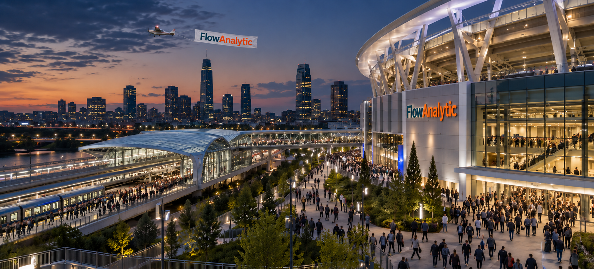
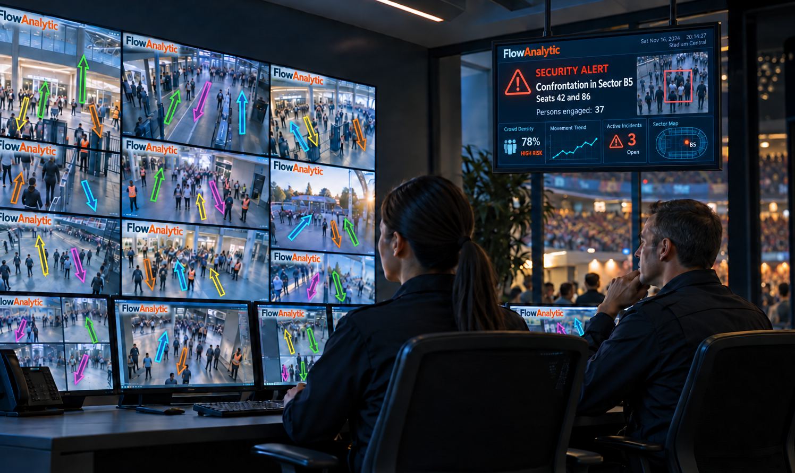

At FlowAnalytic, we develop real-time video analytics that measure organized motion in dense, unstructured scenes: pedestrian crowds, vehicle traffic and drone formations. Where conventional object detection struggles because people and vehicles overlap, FlowAnalytic separates intersecting flows and reports the size, direction and speed of each moving group within a few video frames.

Our software builds on published methods for tracking dense motion in live-cell microscopy. It measures motion, not identity, and uses no facial recognition. It is light enough for edge devices and has run live in a phone app.

FlowAnalytic supports crowd safety at stadiums, transport hubs and public events, traffic monitoring, and situational awareness at critical infrastructure. We welcome collaborations with camera and video-management partners, integrators and public-safety organizations.

- [Contact us](mailto:alexandre.matov@gmail.com)
