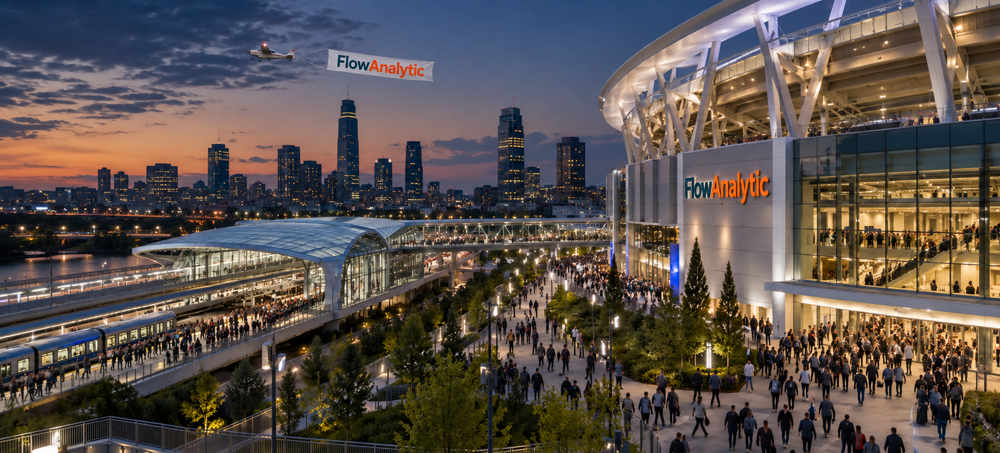
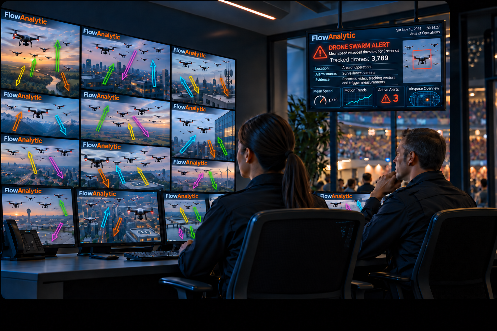

We’re building **FlowAnalytic**, software that turns video into real-time measurements of dense, organized motion, with applications in public safety, defense, and life sciences.

Control rooms monitor hundreds of camera feeds, yet dense crowds remain difficult to interpret. Crowd crushes develop under high density and compression, often alongside counterflow, convergence, and crowd turbulence—patterns that operators may struggle to spot across many screens. Analytics that count people or follow a single dominant flow do not fully describe these overlapping movements.

FlowAnalytic measures motion at scales ranging from individual objects to thousands of tracked features at once. It combines multiple detection methods with three tracking algorithms to measure position, displacement, speed, and direction; reconstruct trajectories; and separate intersecting flows. It also quantifies how speed and direction vary within a scene. We have applied FlowAnalytic to more than 70 distinct motion scenarios.

**Defense and security**

We have applied FlowAnalytic to military-drone footage, dense drone swarms, drone-swarm engagement, crowds, airport terminals, border-control scenes, pedestrian crossings, and traffic.

FlowAnalytic also runs directly inside network surveillance cameras as a camera application. It analyzes the camera’s own live video in real time, without a separate computer or cloud upload. We tested on-camera processing on a remote surveillance camera and built application packages for two generations of camera processors.

**Live feeds and VMS integration**

We connected FlowAnalytic to two live feeds overlooking a busy city-center pedestrian area: a public live stream and a city traffic camera. Processing ran entirely on our cloud server alongside an enterprise video management system (VMS), which received the live feed while FlowAnalytic tracked its motion in real time.

The alert workflow starts with a baseline measurement of normal motion to inform the threshold. When mean flow speed remains above the configured limit for a sustained period, FlowAnalytic sends an event to the VMS, which creates an alarm linked to that camera.

During a live city-center capture, the alerting system was connected to the VMS, but no alert fired as the crowd moved steadily. On a live public highway feed, the same event-to-alarm chain produced four alarms. For one, we preserved a frame-by-frame evidence sequence with tracking vectors and measurements showing exactly why the alert fired.

Within a configured VMS workflow, operators can receive camera-linked alarms in their monitoring client, investigate incidents, and display the relevant feed on a video wall. Our goal is to give them earlier visibility into counterflow, sudden increases in speed, dispersal, and flows converging at choke points—supporting decisions to open exits, redirect people, or dispatch staff.

“Beyond the walls of intelligence, life is defined.”

**What we’re building next**

We’re bringing on-camera processing and VMS alerts together in one demonstration: FlowAnalytic running inside a surveillance camera overlooking a live crowded scene, sending alerts through the VMS, and preserving evidence that explains each trigger.

The camera application now includes speed measurements based on camera-frame timestamps, an alert rule applied within a selected region, and a rolling history of measurements and tracking vectors before and after each alert. Next, we are connecting camera-generated events to the VMS and completing synchronized visual evidence capture.

**“It’s beyond my control”**

We welcome pilot sites with surveillance cameras overlooking busy pedestrian areas, including transit stations, plazas, venue entrances, and shopping streets.

Beyond existing street and venue camera networks, public-safety applications include compact cameras for police cars, fire trucks, schools, and border-patrol operations. Defense applications include drone and drone-swarm tracking and perimeter monitoring.

- [Contact us](mailto:alexandre.matov@gmail.com)
